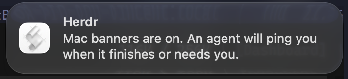

# Mac notifications

Notification Center banner when a Herdr agent finishes or needs input. The in-app toast is unchanged. This plugin only adds the macOS banner.



It listens for `pane.agent_status_changed` and banners `blocked` (needs you) and `done` (finished). After one second it checks that the status still holds. It stays quiet when that pane is focused and WezTerm, Terminal, iTerm, Ghostty, Alacritty, or Kitty is the frontmost app. The same pane and status are skipped for 8 seconds.

Requires Herdr 0.9.0 or newer, macOS, `/usr/bin/osascript`, and Python 3.10+ as `python3` on `PATH`.

## Install

```bash
git clone https://github.com/varvand/herdr-plugin-mac-notify.git ~/.config/herdr/plugins/mac-notify
herdr plugin link ~/.config/herdr/plugins/mac-notify --enabled
```

Or:

```bash
herdr plugin install varvand/herdr-plugin-mac-notify
```

Keep Herdr toasts on in config. This plugin does not replace them:

```toml
[ui.toast]
delivery = "herdr"
delay_seconds = 1
```

Send a test banner:

```bash
HERDR_MAC_NOTIFY_TEST=1 python3 ~/.config/herdr/plugins/mac-notify/notify.py
```

Banners posted with `osascript` are attributed to Script Editor.
